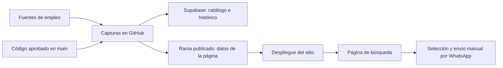

# Manual del cliente — Adaptia Jobs

Versión documental: 5 de noviembre de 2026. Describe el código de `main` tras los PR 6–11. Que un cambio esté fusionado
no demuestra que ya haya pasado por una captura y llegado a la página; comprobarlo como se indica abajo.

## 1. Qué recibe y por dónde empezar

Adaptia Jobs reúne ofertas de empleo, reconoce cargos afines, estima desde dónde se puede aplicar y comprueba sus
enlaces. El operador busca y selecciona oportunidades para compartirlas con sus clientes.

Hay dos resultados distintos:

- **Catálogo del buscador:** ofertas de las familias configuradas, con ventana activa de 30 días y actualización frecuente.
- **Selección diaria:** meta de 20 ofertas distintas por cada uno de estos seis roles: Product Designer, UX/UI Designer,
  Product Owner, Product Manager, AI Engineer y QA. Son 120 en total si todos alcanzan la meta.

El cliente no necesita instalar Python ni dejar encendido su computador para el uso habitual. GitHub ejecuta las búsquedas;
Supabase conserva los datos; el navegador muestra la página. Las cuentas y sus permisos sí deben mantenerse activos.
El administrador configura los accesos una vez siguiendo [Instalación automática](INSTALACION_AUTOMATICA.md). Las
actualizaciones aprobadas preparan la base sin que el operador copie SQL 002/003 ni active variables. Si falla la
preparación, se muestra el motivo y se conserva la copia cifrada disponible; no reiniciar reservas para desbloquearla.
Para consultar después las claves y entregarlas al propietario, usar un gestor compartido siguiendo
[Credenciales y accesos](CREDENCIALES_Y_ACCESOS.md). La guía explica qué clave es cada una; no contiene valores privados.

| Situación | Documento y acción |
|---|---|
| El sistema ya está funcionando y voy a usarlo | Seguir este manual desde la sección 3; no reinstalar ni reemplazar claves |
| Voy a configurarlo en cuentas nuevas | [Instalación](INSTALACION.md), en orden |
| Voy a recibir el proyecto con su historial | [Traspaso](TRASPASO.md); acordar continuidad antes de copiar el repositorio |
| Hay una ejecución fallida o datos antiguos | [Operación y recuperación](OPERACION_Y_RECUPERACION.md) |
| Necesito decidir si está listo para entregar o automatizar WhatsApp | [Aceptación y estado](ACEPTACION_Y_ESTADO.md) |

## 2. Qué significan GitHub, entorno, PR y publicación

- **Repositorio:** carpeta del proyecto en GitHub; contiene el programa, su configuración y estos manuales.
- **`main`:** versión aprobada del código. Se usa en las siguientes ejecuciones.
- **PR:** propuesta de cambio que se revisa antes de fusionar en `main`. Fusionarlo no ejecuta por sí solo una captura.
- **`publicado`:** resultado de las capturas, datos de trabajo y archivos de la página. Los flujos lo actualizan automáticamente.
- **Actualizar página:** despliegue que hace visible el resultado en GitHub Pages. En Cloudflare se usa su propio despliegue.
- **Entorno de trabajo:** máquina de nube donde se prepara y prueba código. «Local» puede referirse a esa máquina;
  no significa que las búsquedas productivas dependan del computador del operador ni del plan de este chat.
- **Supabase:** base de datos operativa e histórica. El producto ya no ofrece hojas de cálculo como destino o descarga.
- **Apify:** refuerzo de ofertas formales de LinkedIn con presupuesto acotado. También se utiliza LinkedIn público sin cuenta.

El circuito es: cambio aprobado → siguiente captura con ese código → guardado y reporte → despliegue → página actualizada.
Cada paso puede tener su propio resultado; una marca verde de pruebas no certifica el último dato publicado.

La página utiliza los datos publicados; la clave privada de Supabase no se entrega al navegador.

## 3. Revisión inicial de una instalación existente

1. Abrir la URL que entregue el administrador. Guardarla como favorita.
2. Entrar en **Estado** y leer la fecha y hora de la última captura. No confundirla con la fecha de la selección diaria.
3. Comprobar que el catálogo no tenga filas pendientes de sincronizar y que la selección muestre cantidades por rol.
4. Comprobar que aparecen los estados de verificación de enlaces. Si todavía no aparecen tras un cambio, puede faltar
   una captura con la versión nueva o su despliegue. No basta con recargar una página que sigue sirviendo datos antiguos.
5. Pedir al administrador evidencia de una ejecución de **Bodega nocturna**, una de **Captura horaria** y el despliegue
   correspondiente. Debe distinguirse una ejecución real de una que tenía `prueba` activada o pasos omitidos.
6. Confirmar los accesos a GitHub, Supabase y Apify con cuentas del cliente. No enviar contraseñas ni tokens por chat.

La lista formal de aceptación está en [ACEPTACION_Y_ESTADO.md](ACEPTACION_Y_ESTADO.md).

## 4. Buscar oportunidades para una persona

1. Entrar en **Buscar** y escribir el cargo, por ejemplo `UX/UI designer`.
2. Elegir la sugerencia cuando corresponda. En **Cargos incluidos** se pueden revisar coincidencias exactas, similares
   y cercanas. La pestaña **Cargos** muestra el mapa disponible.
3. Elegir el país desde donde puede trabajar la persona. LATAM y España están incluidos; las remotas mundiales pueden
   servir para varios países. No hay preferencia automática por Colombia por utilizar el horario de Bogotá.
4. Mantener **Remotas** activado. Desactivar **Presenciales** si ese cliente no puede desplazarse.
5. Activar **País confirmado** cuando sea necesario exigir una ubicación con confianza alta. Revisar siempre restricciones
   de residencia, permiso de trabajo o huso horario en la oferta original. «Remoto» no equivale a «desde cualquier país».
6. Elegir el orden:
   - **Remotas para más países primero:** orden inicial que favorece alcance amplio.
   - **Más parecidas primero:** favorece la coincidencia del cargo.
   - **Más nuevas primero:** favorece fecha de publicación conocida o detección cuando falta fecha.
7. Para máxima frescura, usar **Publicación con hora confirmada → Últimas 2, 6 o 24 horas**. Ese filtro excluye ofertas
   que solo informan una fecha, aunque podrían ser recientes; no se inventan sus horas.
8. Activar **Solo enlaces comprobados** para trabajar únicamente con fichas con comprobación vigente.
9. Revisar idioma, seniority, años, salario y pertinencia antes de compartir. Un cargo cercano es una oportunidad de
   exploración, no una equivalencia profesional garantizada.

Ejemplo: una persona UX/UI en México puede considerar UX Designer, Product Designer, Interaction Designer o UX Researcher
según su experiencia. Un Product Owner puede aparecer como cercano y requerir habilidades diferentes. La página no
deduce automáticamente que todos esos puestos encajen con esa persona.

Las consultas y variantes rotan. El sistema no recorre todos los títulos de todos los países en cada ejecución, ni
cubre todo LinkedIn. La meta diaria se limita a los seis roles; buscar otro cargo no le añade una cuota diaria nueva.

## 5. Interpretar las fechas y los números

| Dato | Significado | Interpretación que debe evitarse |
|---|---|---|
| Publicada | Fecha/hora que proporciona la fuente | Suponer que una modificación es publicación nueva |
| Detectada | Primera vez registrada por el programa | Afirmar que el empleador acaba de publicarla |
| Última observación | Última lectura efectiva en una fuente | Renovarla solo por cargar la página o releer caché |
| Enlace comprobado | Se pudo verificar el enlace en la hora mostrada | Garantizar que la empresa sea auténtica o que nunca cierre |
| Nuevas hoy en la bodega | Detectadas por primera vez ese día | Todas publicadas en las últimas 24 horas |
| 20 por rol | Seleccionadas para ese rol en la fecha indicada | 20 sumadas entre los seis roles |
| Filas sincronizadas | Registros aceptados por Supabase, incluidos existentes | Ofertas distintas o inserciones totalmente nuevas |
| Faltaron | Diferencia frente a la meta de ese rol | Un fallo de todo el programa necesariamente |

Una oferta puede tener enlace LinkedIn y enlace directo. Por eso 120 ofertas pueden generar, por ejemplo, 162 filas
en la tabla histórica. Las capturas horarias no crean otras 120 ofertas ni marcan envíos a clientes.

## 6. Qué hacer con los estados del enlace

| Estado visible | Qué se sabe | Qué hace el operador |
|---|---|---|
| Enlace comprobado | Hay una ficha específica accesible y compatible con el anuncio | Revisar condiciones y utilizar el enlace ofrecido |
| Enlace por verificar | Falta evidencia, caducó la comprobación o el sitio bloqueó la lectura | No incluirlo en la selección automática; revisar y comunicar al administrador |
| Oferta retirada por evidencia | Hubo cierre, 404, ciclo, página general o cobro detectado | Conservar referencia histórica; no compartir como oportunidad vigente |

Un 403, CAPTCHA, login o timeout no demuestra fraude ni cierre. Un ciclo de aplicación puede depender de una sesión.
La comprobación recorre la ficha y un paso visible de aplicación por lectura: no completa formularios ni inicia sesión.
Una petición de pago oculta después de registrarse puede quedar fuera de lo observado.

Si solo uno de los dos enlaces funciona, la aplicación puede conservar la oferta y compartir únicamente el comprobado.
Una comprobación positiva caduca a las seis horas; los pendientes se reintentan según sus límites, con caché de treinta
minutos. No se comprueban diez mil enlaces en cada captura: la revisión es gradual y prioriza el lote del día.

Para reportar un problema al responsable: copiar el cargo, empresa, URL, fecha/hora y qué ocurrió. No enviar cookies,
credenciales ni datos de formularios. La página no incluye todavía un sistema de incidencias ni una aprobación manual
que convierta un enlace pendiente en verificado.

## 7. Compartir por WhatsApp y conservar el historial del operador

1. Revisar condiciones y marcar ofertas con comprobación vigente. **Elegir las 20 primeras** selecciona hasta 20
   resultados aptos de la búsqueda actual; no es la selección automática de los seis roles.
2. Pulsar **Copiar para WhatsApp**. El texto se prepara en bloques de hasta 15 ofertas.
3. Abrir WhatsApp, pegar, revisar los destinatarios y enviar manualmente.
4. Solo después, pulsar **Marcar enviadas**. Copiar no demuestra que un mensaje haya llegado a una persona.
5. **Ocultar enviadas** evita volver a mostrarlas en ese historial del operador.

En GitHub Pages, las marcas se conservan en ese navegador. Otro dispositivo, el modo incógnito o borrar datos del
navegador puede mostrar un historial distinto. En **Estado → Historial de enviadas**, utilizar **Exportar historial** e
**Importar historial** para trasladarlo. Esto no reemplaza el registro diario guardado en Supabase ni registra destinatarios.
Cloudflare con KV puede compartir marcas entre dispositivos de los operadores; no es seguimiento individual por cliente.

Las ofertas y las selecciones diarias se conservan en Supabase. La exportación/importación de **Historial de enviadas**
es un JSON con marcas del navegador; no es una exportación de vacantes, una hoja de cálculo ni un respaldo de Supabase.

## 8. Horarios y búsquedas a pedido

Todos los horarios de este manual son de **Colombia/Bogotá (UTC−5)**:

| Proceso | Programación | Resultado |
|---|---|---|
| Bodega nocturna | 1:17 a. m. todos los días | Captura amplia, controles, selección diaria y sincronización |
| Captura horaria | Minuto 23 de cada hora | Renueva catálogo y comprobaciones acotadas; no consume Apify |
| Actualizar página | Después de capturas/búsqueda profunda, con Pages habilitado | Publica los archivos disponibles |

Son horas solicitadas de inicio. GitHub puede retrasar o saltar ejecuciones; los procesos también esperan su turno.
La página se actualiza cuando termina la captura y el despliegue. Cambiar de país en el filtro no cambia el horario.

Para buscar a pedido, el administrador puede usar **GitHub → Actions → Búsqueda profunda → Run workflow**, rama `main`,
con cargo y código de país (por ejemplo `MX`, `ES` o vacío para cobertura amplia). No crea otra selección diaria. Puede
usar Apify dentro del presupuesto compartido; no tiene un modo de prueba en ese formulario. En Cloudflare configurado,
el botón de búsqueda profunda puede despacharla desde la página. En GitHub Pages se utiliza el acceso a Actions.
Los resultados pueden quedar pendientes de verificación: una búsqueda profunda no certifica todas las ofertas de golpe.

## 9. Rutina del operador

**Cada día, antes de compartir:** revisar hora de datos, selección por rol, pendientes Supabase y comprobación de enlaces;
abrir una muestra de los seis roles y comprobar elegibilidad y acceso a la aplicación. Si se detecta un cobro o una ficha
distinta, apartarla y reportarla aunque antes figurara comprobada.

**Cada semana:** el administrador revisa errores repetidos por fuente, déficit por rol, saldo Apify, capacidad/uso de
Supabase, ejecuciones retrasadas y copias de seguridad. No aumentar presupuesto ni borrar memoria para hacer cuadrar cifras.

**Al cambiar de cuentas o de versión:** conservar respaldos, pasar por el traspaso/aceptación y comprobar la página real.

## 10. Alcance y límites de esta entrega

No existe una garantía de cero fallos externos ni de 120 ofertas nuevas y útiles todos los días. El programa debe
mostrar déficit o incertidumbre en lugar de inventar datos. Los planes gratuitos, la oferta del mercado, los bloqueos
de portales y los cambios de formato afectan cobertura, costo y continuidad.

Todavía no hay agente WhatsApp, registro individual de destinatarios, clientes ni seguimiento de candidaturas.
Ver que una oferta cerró no permite conocer si una persona fue rechazada. Esa etapa requiere datos y autorizaciones
propios; no está incluida como una función ya disponible.

Para aprender qué guardan GitHub y Supabase, qué es un PR y cómo se conservan presupuesto y tareas ante un corte, leer
[Estado operativo explicado](ACTIVAR_ESTADO_OPERATIVO.md). Al activarlo, **Estado** informa tareas/selecciones sin confirmar;
el operador revisa y el administrador corrige la causa. No vaciar pendientes ni reiniciar saldo. La guía distingue
código preparado de activación real; las cachés siguen en GitHub y aún hacen falta respaldos y supervisión externos.

La información técnica, recuperación y pendientes comprobables están en [OPERACION_Y_RECUPERACION.md](OPERACION_Y_RECUPERACION.md)
y [ACEPTACION_Y_ESTADO.md](ACEPTACION_Y_ESTADO.md). El [historial de cambios](HISTORIAL_CAMBIOS.md) explica las revisiones.
Las decisiones para mantener el producto están en [REVISION_FIABILIDAD.md](REVISION_FIABILIDAD.md).
